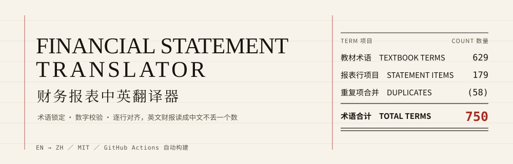
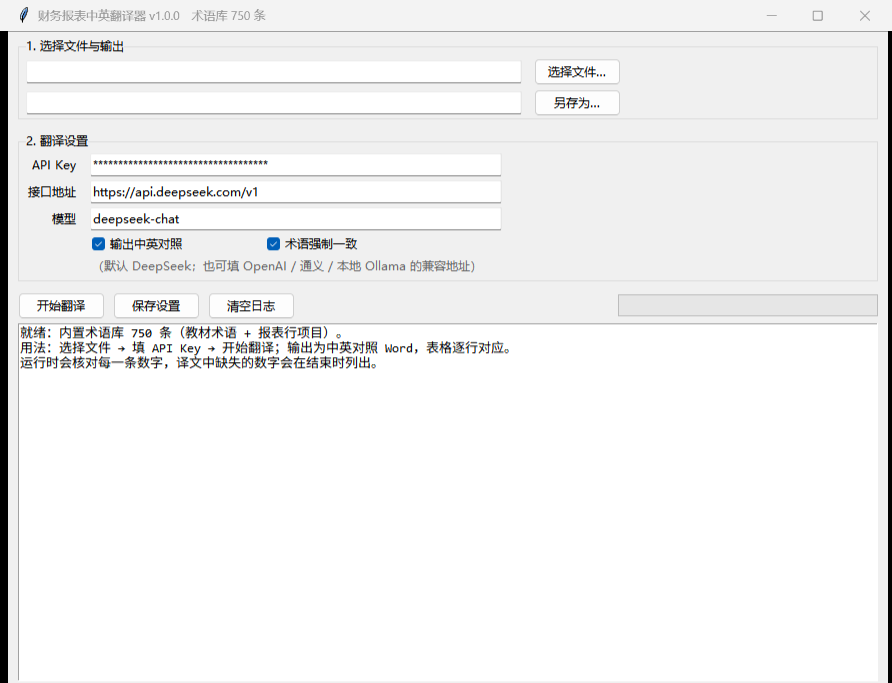

<p align="center">
  
</p>

<p align="center">
  <a href="https://github.com/wsy1022/accounting-audit-en-zh/actions/workflows/build.yml"></a>
  <a href="https://github.com/wsy1022/accounting-audit-en-zh/releases"></a>
  <a href="LICENSE"></a>
</p>

<p align="center">
  Read an English statement in Chinese: one term base, figures that still foot, rows that stay in their row.<br>
  For finance, audit and cross-border teams — and for students who need an English 10-K to make sense.
</p>

---

## The problem is not translation. It is whether the result still ties out.

Machine translation of a financial statement rarely fails on the sentence. It fails in three places:

- **Terms drift.** `provision` becomes "准备" in one row and "预计负债" in the next, and the reviewer can no longer tell whether it is the same thing.
- **Figures disappear.** One bracketed negative swallowed by a long table, and the statement no longer balances.
- **Rows shift.** The Chinese for line A lands beside line B, and the table becomes unusable.

Four gates hold those three failures down: targeted term injection, a post-translation term-compliance check, a numeric diff, and line-by-line alignment for statement-like input (`L<n>|` protocol).

## Three ways in

| You are | Take this route | Start here |
|---|---|---|
| I want to double-click | `FinancialStatementTranslator.exe` in Releases | Download → pick a file → paste an API key → **开始翻译** |
| I want my AI assistant to read it | `skills/accounting-audit-en-zh/` | Drop the folder into your skills directory, then say "translate this balance sheet" |
| I want to batch it in a script | CLI | `python app/translator.py --cli 10-K.docx -o 10-K_zh.docx` |

Input: `txt / md / csv / docx / xlsx / pdf` (text layer). Output: bilingual Word, or Excel / plain text by extension.

## The term base

| Item | Count |
|---|---:|
| Textbook terms | 629 |
| Statement line items | 179 |
| Duplicates merged | (58) |
| **Total terms** | **750** |

629 + 179 − 58 = 750 — every row accounted for, none counted twice. Plus **155** English→Chinese sentence pairs in `sentence-patterns.md`; learning whole sentences pays better than learning words.

```bash
python skills/accounting-audit-en-zh/scripts/term_lookup.py "net realisable value"
python skills/accounting-audit-en-zh/scripts/term_lookup.py --zh 坏账准备
```

The CSV imports straight into Excel, Anki or any dictionary app.

## Four gates

| Mechanism | What it stops |
|---|---|
| Targeted term injection | Only the terms present in the source (≤80) enter the prompt, so a long list never dilutes attention |
| Term-compliance check | Every prescribed rendering is verified after translation; misses trigger one repair pass, then get reported |
| Numeric diff | All figures in the source are compared against the output; anything missing is listed |
| Line alignment | Statement-like input switches to the `L<n>\|` protocol, one source line to one target line |

## The app

<p align="center">
  
</p>

## What it will not do

- **It does not replace a reviewer.** Notes, contingencies and related-party disclosures still need a bilingual accountant.
- No FX conversion, no unit scaling — figures are copied verbatim and the unit belongs in the header.
- Scanned PDFs need OCR first; this reads the text layer only.
- It is not audit, tax or investment advice.

## Repository layout

```
accounting-audit-en-zh/
├── skills/accounting-audit-en-zh/
│   ├── SKILL.md                        workflow + hard rules + delivery templates
│   ├── references/
│   │   ├── glossary.csv                750 terms
│   │   ├── glossary-statements.csv     179 statement items, maintained separately
│   │   ├── statement-layouts.md        four statements / notes / audit report
│   │   ├── translation-rules.md        numbers, units, classic confusions
│   │   └── sentence-patterns.md        155 sentence pairs
│   └── scripts/term_lookup.py          bilingual lookup, EN ↔ ZH
├── app/
│   ├── translator.py                   GUI + CLI
│   ├── glossary.json                   term base bundled into the exe
│   └── build_exe.bat                   one-click packaging
├── docs/                               banner.svg · app.png
├── examples/                           sample income statement + real output
└── .github/workflows/build.yml         CI packaging
```

## Build it yourself

```bash
pip install pyinstaller python-docx openpyxl pymupdf
cd app
pyinstaller --noconfirm --onefile --windowed --name FinancialStatementTranslator \
  --add-data "glossary.json;." translator.py
```

Output lands in `app/dist/`. Or let CI do it: every push to `main` builds and uploads an artifact, every `v*` tag attaches the exe to the Release.

## Sources and licence

- Terms and sentence patterns were compiled with reference to *Accounting and Auditing English* (贺欣, 温倩, 罗殿英; China Machine Press) for study and translation assistance. Copyright in the textbook remains with its authors and publisher.
- Statement line items follow common IFRS / US GAAP presentation, mapped to PRC GAAP Chinese usage.
- Code: MIT. Documentation and glossary: CC BY 4.0.

<p align="center">
  <sub><b>English</b> · <a href="README.md">中文</a></sub>
</p>
