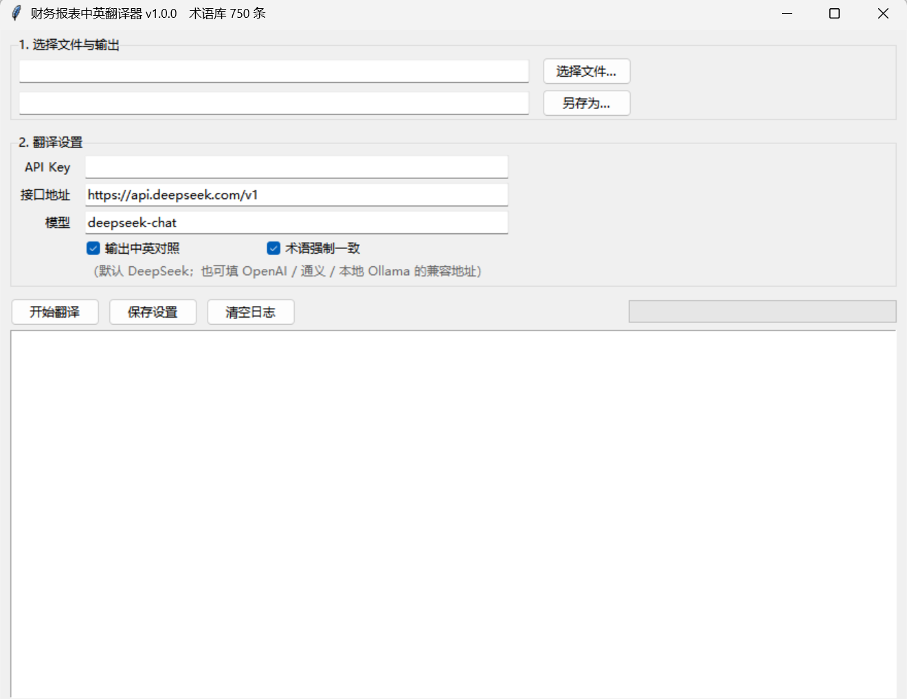

# Financial Statement Translator (EN → ZH)

Translate **English financial statements, annual reports, audit reports and financial data** into Chinese — with a built-in term base that locks professional terminology and a numeric check that flags dropped figures.

[](https://github.com/wsy1022/accounting-audit-en-zh/actions/workflows/build.yml)




Built for finance, audit, banking and cross-border teams — and for students who need to read an English 10-K without guessing what "provision" means.

Two things live in this repo:

| Directory | What it is | Who it's for |
|---|---|---|
| `skills/accounting-audit-en-zh/` | An agent skill: workflow + term base + translation rules + 155 sentence pairs | People who read filings with Claude / ChatGPT / Codex / Hermes |
| `app/` | The runnable translator (GUI + CLI), shipped as a Windows exe | People who want to double-click and go |

---

## 1. Term base (750 entries)

`skills/accounting-audit-en-zh/references/glossary.csv` — **750 entries**:

- **629** core accounting & auditing terms (accounting principles, financial accounting, cost & management accounting, international accounting, auditing)
- **179** statement line items (balance sheet, income statement, cash flow statement, statement of changes in equity, notes, auditor's report, financial ratios)

The CSV imports straight into Excel / Anki / any dictionary app. Look things up:

```bash
python skills/accounting-audit-en-zh/scripts/term_lookup.py "net realisable value"
python skills/accounting-audit-en-zh/scripts/term_lookup.py --zh 坏账准备
```

---

## 2. Using the skill (AI assistant route)

Drop `skills/accounting-audit-en-zh/` into your skills directory (Claude Code: `~/.claude/skills/`; Hermes: `~/AppData/Local/hermes/skills/`), or paste `SKILL.md` at the top of a conversation.

Then say *"translate this English balance sheet"* and the assistant follows this pipeline:

1. Identify the framework (IFRS / US GAAP / CAS) and the units (thousands / millions)
2. Rebuild the statement as a line-item table
3. Apply the term base — never invent a synonym
4. Verify numbers and cross-foot totals
5. Deliver a bilingual table + a terminology report + an open-questions list

Supporting references:

- `references/statement-layouts.md` — structure of the four statements, notes and audit report, line-item mapping, layout traps
- `references/translation-rules.md` — numbers, units, dates, and the classic confusions (`provision` vs `allowance` vs `reserve`, `income` vs `revenue` vs `gain`)
- `references/sentence-patterns.md` — 155 English → Chinese sentence pairs, meant to be memorised whole

---

## 3. Using the exe (no Python required)

Download `FinancialStatementTranslator.exe` from [Releases](../../releases) and double-click:

1. Pick a file (`.docx` `.xlsx` `.txt` `.md` `.csv` `.pdf`)
2. Enter an API key (default endpoint is DeepSeek; OpenAI / any OpenAI-compatible endpoint works, including local Ollama)
3. Hit **开始翻译** (Start) → get a bilingual Word document

CLI works too (requires Python 3.9+):

```bash
python app/translator.py --cli 10-K.docx -o 10-K_zh.docx --bilingual
python app/translator.py --cli balance_sheet.xlsx --zh-only
```

### How accuracy is enforced

| Mechanism | Effect |
|---|---|
| Targeted term injection | Only the terms actually present in the source (≤80) go into the prompt — no diluted long lists |
| Term compliance check | After translating, every expected rendering is verified; misses trigger one repair pass |
| Numeric check | All figures in the source are extracted and diffed against the output; missing numbers are reported |
| Line alignment | Statement-like input (many short lines) switches to a `L<n>\|` protocol, translating line by line so source and target never drift |
| Structure preservation | Paragraph input is chunked; table rows are never merged, items never collapsed |

### Limitations (read before trusting it)

- **Not a replacement for a human reviewer.** Notes, contingencies and related-party disclosures still need a bilingual accountant's eyes.
- No FX conversion and no unit scaling — figures are copied verbatim; the unit belongs in the header.
- Scanned PDFs need OCR first.
- It is not audit, tax or investment advice.

---

## 4. Layout

```
accounting-audit-en-zh/
├── README.md / README.en.md
├── LICENSE
├── .github/workflows/build.yml        # auto-build the exe on CI
├── skills/accounting-audit-en-zh/
│   ├── SKILL.md
│   ├── references/
│   │   ├── glossary.csv               # 750 entries
│   │   ├── glossary-statements.csv    # the 179 statement items, maintained separately
│   │   ├── statement-layouts.md
│   │   ├── translation-rules.md
│   │   └── sentence-patterns.md
│   └── scripts/term_lookup.py
└── app/
    ├── translator.py                  # GUI + CLI
    ├── glossary.json                  # bundled term base
    ├── requirements.txt
    ├── build_exe.bat
    └── README.md
```

---

## 5. Building the exe yourself

```bash
pip install pyinstaller python-docx openpyxl pymupdf
cd app
pyinstaller --noconfirm --onefile --windowed --name FinancialStatementTranslator \
  --add-data "glossary.json;." translator.py
```

Output lands in `app/dist/`. CI does the same thing on every push to `main` and on every `v*` tag
(see `.github/workflows/build.yml`), so you can just download the artifact instead of building.

---

## 6. Sources & disclaimer

- Terms and sentence patterns were compiled with reference to *Accounting and Auditing English* (贺欣, 温倩, 罗殿英; China Machine Press) for study and translation assistance. Copyright in the textbook remains with its authors and publisher.
- Statement line items follow common IFRS / US GAAP presentation practice, mapped to PRC GAAP (《企业会计准则》) Chinese usage.
- The term base is a factual bilingual glossary for study and reference. For commercial or regulatory use, verify against the current standards text.

## License

Code: MIT. Documentation and glossary: CC BY 4.0.

---

[中文版 README](README.md)
